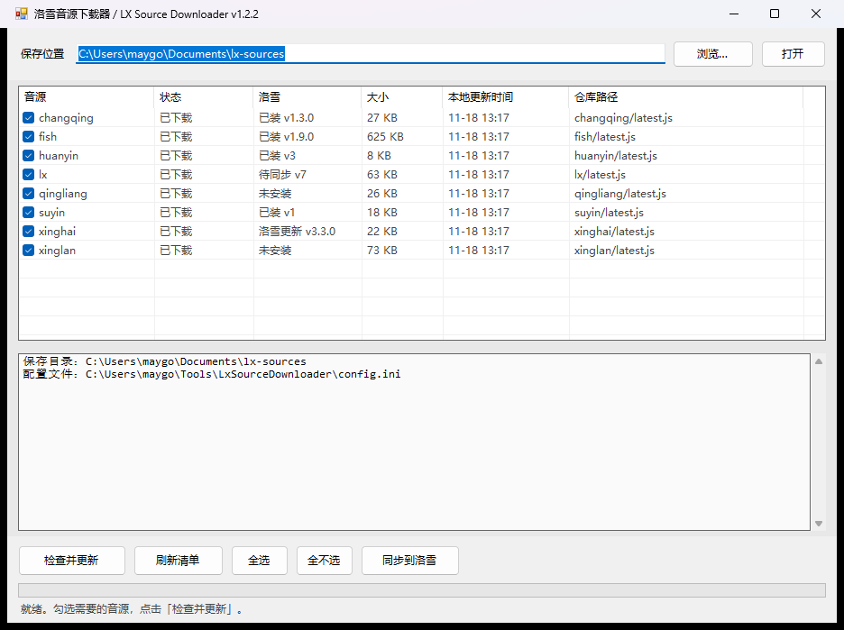

# LX Source Downloader

[](https://github.com/maygo88/lx-source-downloader/actions/workflows/build.yml)
[](https://github.com/maygo88/lx-source-downloader/releases)
[](LICENSE)


**[下载最新版](https://github.com/maygo88/lx-source-downloader/releases/latest)** · 中文说明见
[README.zh-CN.md](README.zh-CN.md)

> 面向 [洛雪音乐](https://github.com/lyswhut/lx-music-desktop) 用户的单文件小工具：一键下载/更新第三方
> 自定义音源，并把音源**直接同步进你本地的洛雪**。SHA-256 内容比对（只写有变化的文件）、加速站自动切换、
> 免安装，一个 50 KB 的 exe。
>
> 它解决的是这几个具体的手工步骤：GitHub 时通时不通；不知道自己的音源是不是最新；已经装进洛雪的音源看不见
> 版本；想把本地脚本塞回洛雪只能一条条手动导入。

A single-file Windows GUI that downloads and updates [LX Music](https://github.com/lyswhut/lx-music-desktop)
custom sources — and reads/writes the sources **already installed** in your LX Music.



*UI strings are Simplified Chinese for now (see [Roadmap](#roadmap)); the code and docs are open for translation.*

## Contents

- [Features](#features)
- [Requirements](#requirements)
- [Install](#install)
- [Usage](#usage)
- [How LX Music stores custom sources](#how-lx-music-stores-custom-sources)
- [Safety when writing to LX Music](#safety-when-writing-to-lx-music)
- [Command line](#command-line)
- [config.ini](#configini)
- [Build from source](#build-from-source)
- [Tests](#tests)
- [Project layout](#project-layout)
- [Roadmap](#roadmap)
- [FAQ](#faq)
- [Related projects](#related-projects)
- [How this project is built](#how-this-project-is-built)
- [Disclaimer](#disclaimer)
- [License](#license)

## Features

- **One exe, under 50 KB, no installer, no runtime download.** Built against .NET Framework 4.8,
  which ships with Windows 10/11. Copy the folder to another PC and double-click.
- **Content-hash updates.** Every source is downloaded and compared by SHA-256 with the previous copy:
  unchanged sources are not rewritten, changed ones replace exactly one file.
- **Mirror failover.** Tries several GitHub mirrors and remembers the first working one, re-probing on failure.
- **LX Music integration.** Reads `user_api.json`, shows which sources are installed and at what version,
  and can push local files back with automatic backup and downgrade protection.
- **Discovery from two directions.** Lists new directories in the upstream repo *and* sources that exist only
  in your LX Music installation (those can be exported to `.js` files).
- **Silent mode.** `LxSourceDownloader.exe /auto` updates everything without a window — handy for Task Scheduler.
- **Defensive startup.** Blocks unsigned DLL injection, which also avoids startup crashes caused by game
  overlay tools (see [FAQ](#faq)).

## Requirements

- Windows 10 or Windows 11 (.NET Framework 4.8 is preinstalled)
- Network access to GitHub or one of the mirrors

## Install

1. Download `LxSourceDownloader-win-x64.zip` from [Releases](https://github.com/maygo88/lx-source-downloader/releases).
2. Extract anywhere (no installation). `config.ini` is created next to the exe on first run.

> The exe is not code-signed, so SmartScreen may warn on first launch: *More info → Run anyway*.

## Usage

1. Pick a **保存位置** (output folder). Defaults to `%USERPROFILE%\Documents\lx-sources`.
2. Click **检查并更新** (*Check & update*) — only new/changed sources are written.
3. Quit LX Music completely (window **and** tray icon), then click **同步到洛雪** (*Sync to LX Music*).
4. Restart LX Music → *Settings → Custom source management* and confirm the version numbers.

### What the 洛雪 column means

| Value | Meaning |
| --- | --- |
| `已装 vX` | Local file and installed script are byte-identical |
| `待同步 vX` | Local differs and is **not older** than the installed one — safe to push |
| `洛雪更新 vX` | Installed version is newer (sources self-update) — sync skips it to avoid a downgrade |
| `未安装` | Not present in LX Music — sync creates a new entry from the script header |
| `仅洛雪 vX` | Exists only in LX Music; tick it and run *Check & update* to export it as a local `.js` |

## How LX Music stores custom sources

```
%APPDATA%\lx-music-desktop\LxDatas\user_api.json
```

(A *single* JSON file — not a folder of `.js` files. `%LOCALAPPDATA%\Programs\lx-music-desktop` is only the
application itself.)

```jsonc
{
  "userApis": [
    {
      "id": "user_api_120_1794793835171",
      "name": "fish_music",
      "description": "...",
      "version": "1.9.0",
      "author": "...",
      "homepage": "...",
      "allowShowUpdateAlert": true,
      "script": "gz_<base64>"
    }
  ]
}
```

`script` is `"gz_" + Base64(zlib(scriptText))`. Despite the prefix it is **zlib** (starts with `78 9C`), not gzip.
Decompressing it yields the original userscript, whose header carries `@name` / `@version`.

## Safety when writing to LX Music

- A timestamped backup is created first: `user_api.json.bak-YYYYMMDD-HHmmss`.
- Only matched entries are modified; ids and unknown fields are preserved.
- Entries whose local version is older than the installed one are skipped (no silent downgrades).
- If LX Music is running you are asked to quit it first — otherwise it would overwrite the file on exit.
- Point the app at a different data file with the `LX_TOOL_DATA` environment variable (portable setups, tests).

## Command line

```bat
LxSourceDownloader.exe /auto
```

Runs an update with no window, writes `auto.log` next to the exe, exits. It does **not** sync to LX Music.

## config.ini

| Key | Meaning |
| --- | --- |
| `outdir=...` | Output folder |
| `source.<name>=<path>` | Source path inside the upstream repo |
| `check.<name>=1\|0` | Whether the row is ticked (persisted) |
| `hash.<name>=...` | SHA-256 of the last downloaded content; delete to force a re-download |
| `time.<name>=...` | Last successful update time |

## Build from source

No SDK, MSBuild or NuGet required — the .NET Framework C# 5 compiler is enough:

```powershell
pwsh ./build.ps1          # -> dist/LxSourceDownloader.exe
```

`build.ps1` locates `csc.exe` under `%WINDIR%\Microsoft.NET\Framework64\v4.0.30319`, compiles with
`/codepage:65001`, embeds `assets/icon.ico`, and reads the version from `src/AssemblyInfo.cs`.

## Tests

`tests/smoke.ps1` drives the built exe against throw-away copies of `config.ini` and
`user_api.json` (redirected with `LX_TOOL_DATA`), so your real LX Music data is never opened:

```powershell
pwsh ./tests/smoke.ps1              # everything, including the GUI-driven sync round trip
pwsh ./tests/smoke.ps1 -SkipGui     # headless only (what CI runs)
```

It covers the failures that have actually bitten users: a corrupt `user_api.json` at startup,
`/auto` exiting on its own, and a sync round trip (add, header metadata, byte-for-byte content,
backup, idempotency, downgrade protection).

## Project layout

```
build.ps1                  # csc-based build script
publish.ps1                # one-off helper: create the repo and push (gh or an explicit URL)
src/LxSourceDownloader.cs  # entire application (single file, ~1.5k lines)
src/AssemblyInfo.cs        # version metadata (single source of truth for the version)
assets/icon.ico            # app icon
tests/smoke.ps1            # end-to-end regression tests (sandboxed user_api.json)
docs/screenshot.png        # README screenshot
docs/PUBLISH.md            # publishing notes (Chinese)
legacy/                    # the original PowerShell/.cmd scripts, kept for reference
.github/workflows/build.yml# CI: build + smoke test on every push, release on v* tags
```

## Roadmap

- [ ] English UI (i18n: extract strings, add `zh-CN`/`en-US` resources)
- [ ] Configurable source repository / mirror list in the UI
- [ ] Code signing (removes the SmartScreen warning)
- [ ] Scheduled-update helper (create the Task Scheduler entry from the UI)
- [ ] Per-source scheduling rules (e.g. skip a source that keeps failing)

## FAQ

**Why does the app block unsigned DLLs?**

Some game overlay / booster tools inject their own DLL into every new GUI process. One of them
(GamePP's `GPP64.dll`) crashes unknown .NET hosts with `0xC0000005` within seconds, which killed this app
during testing. Setting `PROCESS_MITIGATION_BINARY_SIGNATURE_POLICY = MicrosoftSignedOnly` prevents the
injection and makes the app stable. Side effect: third-party IME overlays / translation pop-ups do not attach
to this window. Set `LX_TOOL_NO_MITIGATION=1` to opt out.

**A source shows 洛雪更新 but I want the repository copy anyway.**

That means the installed script is newer (these scripts self-update through their own endpoints). The app
deliberately refuses to downgrade. Delete the file locally and re-run if you really want the repo snapshot.

**The upstream repository moved.**

Change the `Repo` constant at the top of `src/LxSourceDownloader.cs` and rebuild.

## How this project is built

The C# source, build script, CI workflow, icon and documentation are **generated and iterated mainly by
[DeepSeek Harness](https://github.com/deepseek-ai)**, an AI coding agent, under the maintainer's direction.
The maintainer defines the requirements, reviews every change, runs the real-machine checks (clean-clone
build, `/auto`, GUI clicks, LX Music round-trip against a sandboxed copy of `user_api.json`) and signs off
each release. The LX Music round-trip and `/auto` behaviour are also covered by
[`tests/smoke.ps1`](tests/smoke.ps1) and by CI.

Treat the repository like any third-party code: it is plain C# you can read, build and modify, but review it
the way you would review anything that writes to your music app's data file. Questions about *why* something
is implemented a certain way are welcome as issues.

See [README.zh-CN.md](README.zh-CN.md) for the fuller Chinese documentation.

## Related projects

- [lx-music-desktop](https://github.com/lyswhut/lx-music-desktop) — the music player this tool is built for.
- [lx-music-script](https://github.com/lyswhut/lx-music-script) — the userscript framework that custom sources
  are written against.

Neither project is affiliated with this tool.

## Disclaimer

This tool is not affiliated with LX Music, its authors, or the maintainers of any source repository. It only
downloads public files from a third-party GitHub repository. The custom sources themselves are provided by
their authors; availability and legality depend on your jurisdiction. Use at your own risk.

## License

[MIT](LICENSE) © 2026 haungsheng and contributors
