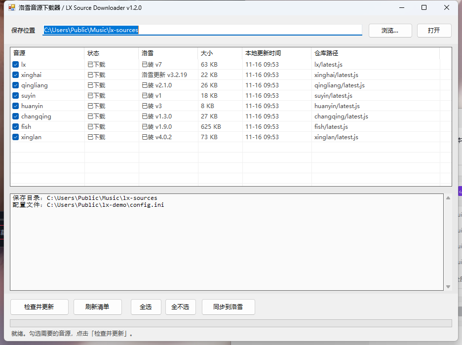

# 洛雪音源下载器 / LX Source Downloader

[](https://github.com/maygo88/lx-source-downloader/actions/workflows/build.yml)
[](https://github.com/maygo88/lx-source-downloader/releases)
[](LICENSE)

单文件 Windows GUI：下载/更新 [洛雪音乐](https://github.com/lyswhut/lx-music-desktop) 的自定义音源，
并且能直接读写**洛雪里已经安装**的音源。



English: [README.md](README.md)

## 功能

- **46 KB 单文件，免安装、免下载运行时**：基于 Windows 10/11 自带的 .NET Framework 4.8。整个文件夹拷走即可用。
- **按内容哈希更新**：每个音源下载后与上次的 SHA-256 比对，没变的不写盘，变了的只替换那一个文件。
- **加速站自动容错**：依次尝试多个 GitHub 镜像，记住第一个可用的，失败自动重新探测。
- **洛雪集成**：读取 `user_api.json`，显示已装版本；可一键写回，自带备份与防降级。
- **双向发现**：既列出上游仓库新增的目录，也列出只在洛雪里存在的音源（可导出成 `.js`）。
- **静默模式**：`LxSourceDownloader.exe /auto`，无窗口更新，适合挂计划任务。
- **防御式启动**：阻断未签名 DLL 注入，顺带规避游戏 overlay 导致的启动崩溃（见 FAQ）。

## 系统要求

- Windows 10 / 11（自带 .NET Framework 4.8）
- 能访问 GitHub 或其镜像

## 安装

1. 到 [Releases](https://github.com/maygo88/lx-source-downloader/releases) 下载 `LxSourceDownloader-win-x64.zip`
2. 解压到任意目录，双击 exe；首次运行会在同目录生成 `config.ini`

> exe 没有代码签名，首次启动 SmartScreen 可能提示：更多信息 → 仍要运行。

## 使用

1. 选「保存位置」（默认 `%USERPROFILE%\Documents\lx-sources`）
2. 点「检查并更新」——只写新增/变化的音源
3. **完全退出洛雪**（窗口 + 托盘图标），点「同步到洛雪」
4. 重启洛雪 → 设置 → 自定义源管理，确认版本号已变

### 「洛雪」列

| 显示 | 含义 |
| --- | --- |
| `已装 vX` | 本地文件与洛雪里的一致 |
| `待同步 vX` | 本地不同且不比已装版本旧，可以推送 |
| `洛雪更新 vX` | 洛雪里的更新（脚本会自更新），同步会跳过以免降级 |
| `未安装` | 洛雪里没有 |
| `仅洛雪 vX` | 只在洛雪里有；勾选后「检查并更新」会导出成本地 `.js` |

## 洛雪的音源存在哪

```
%APPDATA%\lx-music-desktop\LxDatas\user_api.json
```

是**一个 JSON 文件**，不是一堆 `.js`（安装目录 `%LOCALAPPDATA%\Programs\lx-music-desktop` 只是程序本体）。

```jsonc
{ "userApis": [ { "id": "...", "name": "...", "version": "...", "script": "gz_<base64>" } ] }
```

`script` 是 `"gz_" + Base64(zlib(脚本原文))`——前缀叫 `gz_`，实际是 **zlib**（`78 9C` 开头），不是 gzip。
解压后就是原始 userscript，头部带 `@name` / `@version`。

## 写入洛雪的安全措施

- 写入前自动备份：`user_api.json.bak-年月日-时分秒`
- 只改动匹配到的条目，id 与未知字段原样保留
- 本地版本更旧的一律跳过，绝不静默降级
- 洛雪运行中会提示先退出（否则它退出时会把旧数据写回）
- 用 `LX_TOOL_DATA` 环境变量可指向别的 `user_api.json`（便携版/测试）

## 命令行

```bat
LxSourceDownloader.exe /auto
```

无窗口更新，结果写入同目录 `auto.log` 后退出；**不会**自动同步到洛雪。

## config.ini

| 键 | 含义 |
| --- | --- |
| `outdir=...` | 保存位置 |
| `source.<名字>=<路径>` | 音源在仓库里的路径 |
| `check.<名字>=1\|0` | 该行是否勾选（会持久化） |
| `hash.<名字>=...` | 上次内容的 SHA-256，删掉即强制重下 |
| `time.<名字>=...` | 上次更新时间 |

## 从源码构建

不需要 SDK / MSBuild / NuGet，.NET Framework 自带的 C# 5 编译器就够：

```powershell
pwsh ./build.ps1          # 产物：dist/LxSourceDownloader.exe
```

## 目录结构

```
build.ps1                   # csc 构建脚本
src/LxSourceDownloader.cs   # 全部程序逻辑（单文件，约 1400 行）
src/AssemblyInfo.cs         # 版本信息
assets/icon.ico             # 图标
docs/screenshot.png         # README 截图
.github/workflows/build.yml # CI：每次推送构建，打 v* 标签发 Release
```

## 路线图

- [ ] 英文界面（抽字符串，加 `zh-CN` / `en-US` 资源）
- [ ] 界面里可配置上游仓库与镜像列表
- [ ] 代码签名（消除 SmartScreen 提示）
- [ ] 一键创建计划任务
- [ ] 单个音源的更新策略（例如持续失败就跳过）

## FAQ

**为什么要拦截未签名 DLL？**

部分游戏 overlay / 加速器会往每个新进程注入自己的 DLL。实测游戏加加的 `GPP64.dll` 会在几秒内让
未知的 .NET 宿主以 `0xC0000005` 崩溃，本程序开发期间就是被它带崩的。启用
`PROCESS_MITIGATION_BINARY_SIGNATURE_POLICY = MicrosoftSignedOnly` 挡掉注入后即稳定。
副作用：第三方输入法悬浮窗 / 划词翻译不会挂到本窗口。设置 `LX_TOOL_NO_MITIGATION=1` 可关闭该策略。

**显示「洛雪更新」但我就是想用仓库那份？**

说明已装版本更新（这类脚本会自更新）。程序故意拒绝降级；确需覆盖就先删掉本地文件再更新。

**上游仓库换地址了？**

改 `src/LxSourceDownloader.cs` 顶部的 `Repo` 常量，重新构建。

## 免责声明

本工具与洛雪音乐、其作者以及任何音源仓库维护者均无关联，只是从第三方 GitHub 仓库下载公开文件。
音源本身由其作者提供，可用性与合法性取决于你所在地区的法律，使用风险自负。

## 许可证

[MIT](LICENSE) © 2026 maygo88 and contributors
